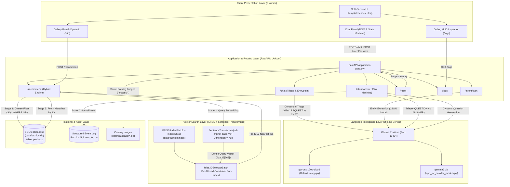
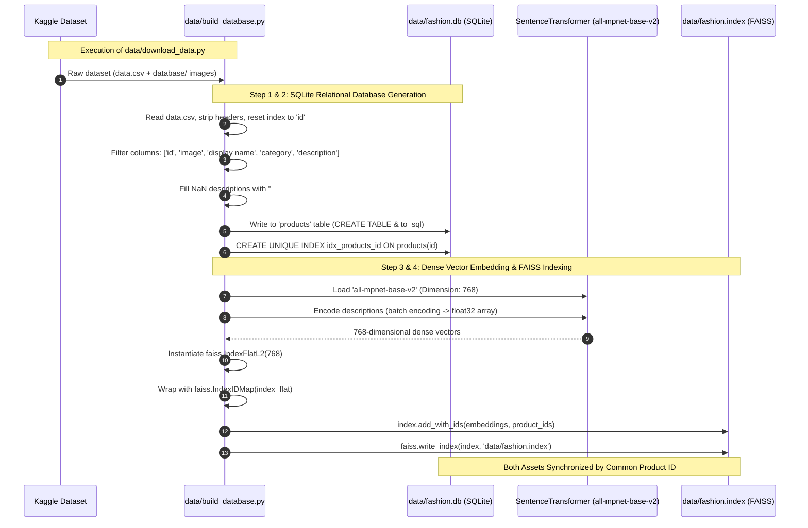
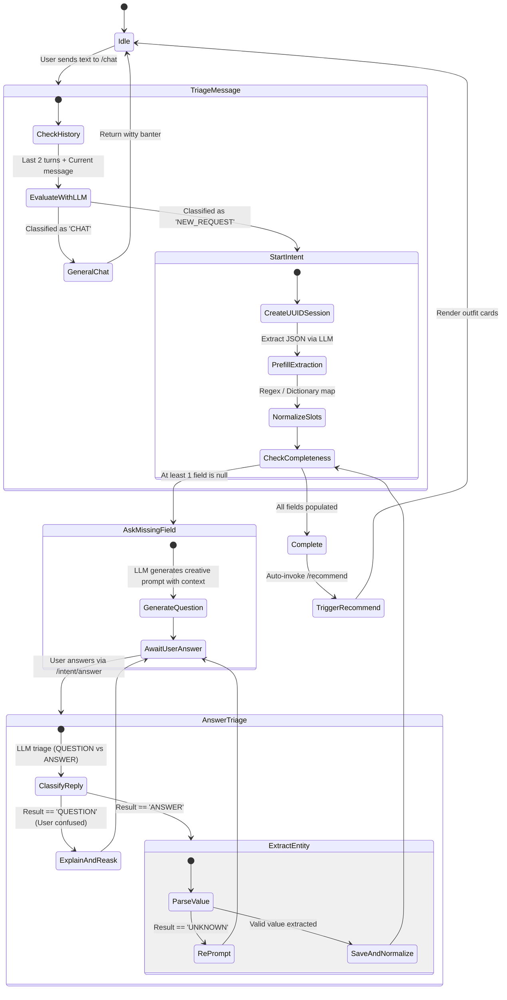
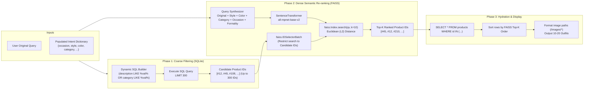

# FashionAI — Comprehensive Project Documentation & Architecture Guide

## 1. Executive Summary & Project Overview

**FashionAI** is an AI-powered conversational fashion stylist and outfit recommendation system. The application bridges the gap between natural language human expression and dense multimodal catalog retrieval. Rather than requiring users to manually configure complex search filters, FashionAI uses a multi-turn dialogue agent that diagnoses fashion needs, extracts aesthetic and situational constraints, clarifies ambiguous terms, and performs hybrid semantic search over an indexed fashion catalog.

```
+--------------------------------------------------------------------------------------------------+
|                                        FashionAI System                                          |
|                                                                                                  |
|   +--------------------+      +---------------------------------+      +---------------------+   |
|   |    User Request    | ---> | Multi-Turn Intent State Machine | ---> |  Hybrid Retrieval   |   |
|   | ("date night look")|      |   (Ollama LLM + Triage Engine)  |      |   (SQL + FAISS L2)  |   |
|   +--------------------+      +---------------------------------+      +---------------------+   |
|                                                                                   |              |
|                                                                                   v              |
|                                                                        +---------------------+   |
|                                                                        |  Top Outfits Visual |   |
|                                                                        |    Gallery Grid     |   |
|                                                                        +---------------------+   |
+--------------------------------------------------------------------------------------------------+
```

### Key Capabilities
- **Context-Aware Dialogue Routing**: Distinguishes between casual conversation and actionable outfit requests using recent conversational context.
- **Dynamic Multi-Turn Entity Extraction**: Iteratively collects missing fashion dimensions (`occasion`, `category`, `formality`, `gender`, `color`, `style`) without rigid forms.
- **Intelligent Clarification & Educational Dialogues**: Detects user confusion (e.g., asking *"what is formality?"*) and defines concepts before re-asking the question.
- **Synonym Normalization**: Maps colloquial inputs (e.g., *"date night"*, *"smart"*, *"lady"*, *"dark blue"*) to canonical database tokens.
- **Hybrid Retrieval Architecture**: Combines coarse relational database filtering (SQLite) with dense vector semantic search (`all-mpnet-base-v2` + FAISS) using candidate ID masking.
- **Dual Inference Engine Support**: Tailored implementations for high-capacity cloud models (`gpt-oss:120b-cloud`) and local edge models (`gemma3:1b`).
- **Real-Time Observability**: In-browser debug HUD inspector and persistent structured event logging.

---

## 2. System Architecture & High-Level Design

The FashionAI architecture follows a decoupled, layered micro-architecture consisting of five major layers:

1. **Client Presentation Layer**: Interactive split-screen web application (Vanilla HTML5/CSS3/JavaScript) providing real-time chat, visual gallery, and debug tools.
2. **Application & Routing Layer**: Asynchronous FastAPI server managing REST endpoints, session state machines, request validation, and static asset serving.
3. **Language Intelligence Layer**: Local or remote LLM inference server (Ollama) driving conversation triage, zero-shot entity extraction, confusion classification, and dynamic question synthesis.
4. **Semantic Vector Search Engine**: Sentence-Transformers model (`all-mpnet-base-v2`) generating dense 768-dimensional embeddings, queried against a FAISS flat L2 vector index wrapped in an ID-map.
5. **Relational Storage & Asset Layer**: SQLite database (`fashion.db`) storing product metadata and raw image catalog files served via mounted endpoints.



---

## 3. Technology Stack Breakdown

| Layer | Technology | Version | Purpose in FashionAI |
| :--- | :--- | :--- | :--- |
| **Runtime & Language** | Python | 3.10+ / 3.11 / 3.12 | Core application execution environment |
| **Web Framework** | FastAPI | `0.120.0` | Asynchronous high-performance REST API routing |
| **ASGI Server** | Uvicorn | `0.38.0` | Asynchronous web server hosting the FastAPI application |
| **Data Validation** | Pydantic | `2.12.3` | Request body validation schemas (`ChatInput`, `ResetInput`) |
| **Templating Engine**| Jinja2 | `3.1.6` | Server-side HTML page template rendering |
| **LLM Inference** | Ollama Desktop / CLI | Latest (v0.5+) | Local LLM inference server exposing `/api/generate` |
| **LLM Models** | `gpt-oss:120b-cloud` / `gemma3:1b` | Cloud / Local | Entity extraction, dialogue triage, question synthesis |
| **Dense Embeddings** | Sentence-Transformers | `5.1.2` | Pre-trained model `all-mpnet-base-v2` generating 768-d vectors |
| **Deep Learning** | PyTorch (`torch`, `torchvision`)| `2.9.0` / `0.24.0` | Underlying tensor execution engine for HuggingFace models |
| **Vector Index** | FAISS (`faiss-cpu`) | `1.12.0` | Similarity indexing, fast Euclidean (L2) distance search |
| **Relational Database**| SQLite 3 / `sqlite3` | Built-in | Fast embedded relational database for product catalog metadata |
| **Data Manipulation**| Pandas / NumPy | `2.3.3` / `2.2.6` | Data ingestion, CSV cleaning, array formatting for FAISS |
| **Dataset Source** | KaggleHub | `0.3.13` | Programmatic dataset download (`zara2099/fashion-style-image-dataset`) |
| **Frontend Framework**| Vanilla HTML5 / CSS3 / ES6 JS | Native browser | Zero-dependency, lightweight, reactive user interface |
| **Environment Mgmt** | `python-dotenv` | `1.1.1` | Loads configuration from `.env` (`OLLAMA_HOST`, `OLLAMA_PORT`, etc.) |

---

## 4. Data Engineering & Offline Indexing Pipeline

The data engineering pipeline transforms raw catalog CSVs and images into indexed assets ready for low-latency sub-millisecond retrieval.



### Relational Schema (`products` table in `data/fashion.db`)

| Column | Type | Description | Indexing |
| :--- | :--- | :--- | :--- |
| `id` | `INTEGER` | Unique integer identifier mapped 1:1 with FAISS vector ID | `UNIQUE INDEX idx_products_id` |
| `image` | `TEXT` | Relative path to image file (e.g. `images/1234.jpg`) | Unindexed |
| `display name`| `TEXT` | Brand or product title (e.g. *"Navy Blue Slim Fit Blazer"*) | Unindexed |
| `category` | `TEXT` | Garment taxonomy (e.g. `tshirts`, `shoes`, `dresses`) | Scanned via SQL `LIKE` |
| `description` | `TEXT` | Rich natural language text of garment styling & fabric | Scanned via SQL `LIKE` |

---

## 5. Conversational Multi-Turn Intent State Machine

The core intelligence of FashionAI is an asynchronous state machine managed by `IntentManager` and powered by prompt-engineered Ollama LLM queries.

### Slot Schema Comparison

FashionAI supports two distinct attribute schemas depending on the active script:

| Attribute | Description | Default in `app.py` | Default in `app_for_smaller_models.py` |
| :--- | :--- | :---: | :---: |
| **`occasion`** | Event type (wedding, party, interview, picnic, office) | Yes | Yes |
| **`category`** | Garment taxonomy (t-shirt, jeans, shoes, dress, blazer) | Yes | No |
| **`formality`** | Dress code level (casual, semi-formal, formal, business) | Yes | Yes |
| **`gender`** | Intended wearer (male, female, unisex) | Yes | Yes |
| **`color`** | Dominant garment color (red, blue, black, white, navy) | Yes | No |
| **`season`** | Weather context (summer, winter, autumn, spring) | No | Yes |
| **`style`** | Aesthetic vibe (sporty, elegant, vintage, streetwear) | Yes | Yes |

### 5-Step Intent Lifecycle



### 1. Contextual Message Triage
When a user submits text to `/chat`, the system inspects the last 2 conversation turns. An LLM prompt evaluates whether the text represents an outfit specification (`NEW_REQUEST`) or general follow-up discussion (`CHAT`). This prevents the system from misinterpreting queries like *"what's the weather?"* as clothing searches.

### 2. Zero-Shot Entity Pre-filling
When an intent flow begins (`begin_intent_flow`), the initial query is fed to an entity extractor prompting the LLM for structured JSON output. For example:
- Input: *"i need a black suit for a wedding"*
- Output: `{"occasion": "wedding", "category": "suit", "formality": "formal", "gender": "male", "color": "black", "style": "formal"}`

### 3. Normalization Engine
Raw LLM extraction outputs are processed through a deterministic normalization dictionary (`normalize_field_value`):
- `party outfit`, `birthday outfit` -> `party`, `birthday`
- `work`, `meeting` -> `office`
- `smart` -> `semi-formal`
- `girl`, `woman`, `lady` -> `female`
- `boy`, `man`, `gentleman` -> `male`
- `dark blue` -> `navy`
- `t-shirt` -> `tshirts`, `frock` -> `dresses`

### 4. Confusion & Answer Triage
When collecting an unanswered slot, users sometimes reply with questions (e.g. *"what does formality mean?"* or *"why?"*). Rather than blindly treating this as an outfit parameter, the system:
- Classifies user response as `QUESTION` or `ANSWER`.
- If `QUESTION`: Fetches the predefined field definition from `FIELD_DEFINITIONS`, crafts an empathetic explanation, and re-prompts the user.
- If `ANSWER`: Extracts the single canonical token or returns `UNKNOWN` if ambiguous, triggering an informative re-prompt.

### 5. Creative Dynamic Question Synthesis
Instead of robotic prompts like *"Enter formality:"*, the LLM receives the current intent context and generates conversational questions with emojis, tailored to the specific missing slot.

---

## 6. Hybrid Recommendation Engine (`/recommend`)

FashionAI combines symbolic SQL filtering with dense vector similarity search to produce recommendations that are both semantically relevant and compliant with hard constraints.



### Mathematical & Algorithmic Details

1. **Query Synthesis Formulation**:
   $$\text{Query}_{\text{enriched}} = \text{Query}_{\text{raw}} \cup \text{Style} \cup \text{Color} \cup \text{Category} \cup \text{"for a " + Occasion + " event"} \cup \text{Formality}$$
2. **Dense Vector Projection**:
   $$\vec{q} = \text{SentenceTransformer}(\text{Query}_{\text{enriched}}) \in \mathbb{R}^{768}, \quad \|\vec{q}\|_2 = 1$$
3. **Constrained Subspace Search**:
   Given candidates $C = \{id_1, id_2, \dots, id_m\} \subset \text{Catalog}$, where $m \le 300$:
   $$\text{Top-}k = \arg\min_{i \in C}^{(k)} \|\vec{q} - \vec{v}_i\|_2^2$$
   where $\vec{v}_i$ is the pre-computed embedding of product $i$.
4. **Ranking Preservation**:
   Because SQL `IN (...)` queries do not preserve parameter order in relational results, the Python layer uses an in-memory dictionary lookup:
   ```python
   id_to_row = {row[0]: row for row in rows_final}
   ordered_rows = [id_to_row[id] for id in top_ids if id in id_to_row]
   ```

---

## 7. Dual-Model Variant Architecture

FashionAI includes two backend application files to support different hardware environments:

| Architectural Dimension | `app.py` (Cloud / Large Model) | `app_for_smaller_models.py` (Local / Edge Model) |
| :--- | :--- | :--- |
| **Primary Target Model** | `gpt-oss:120b-cloud` | `gemma3:1b` |
| **Inference Latency Profile**| Network-dependent (API call to cloud host) | Ultra-low latency (Local CPU/GPU inference) |
| **Intent Slots Tracked** | 6 slots (`occasion`, `category`, `formality`, `gender`, `color`, `style`) | 5 slots (`occasion`, `formality`, `gender`, `season`, `style`) |
| **Prompt Complexity** | Multi-shot few-shot examples with contextual personality | Minimalist zero-shot direct prompts with strict token limits |
| **Question Generation** | Conversational, witty banter with emojis | Short, direct questions without stylistic flourishes |
| **Hardware Requirement** | Minimal local RAM (offloaded to cloud Ollama) | 4GB - 8GB local VRAM or 16GB system RAM |

---

## 8. API Specification & Endpoints

All endpoints communicate via JSON unless otherwise specified.

### Endpoint Matrix

| Method | Path | Input / Schema | Output Format | Description |
| :--- | :--- | :--- | :--- | :--- |
| `GET` | `/` | None | `text/html` | Serves main UI (`templates/index.html`) |
| `POST`| `/chat` | `ChatInput` (`text`, `conversation_id`) | `application/json` | Primary dialogue router. Classifies `NEW_REQUEST` vs `CHAT` |
| `POST`| `/intent/start` | `{"query": str}` | `application/json` | Initializes a new intent session and extracts initial slots |
| `POST`| `/intent/answer`| `{"session_id": str, "answer": str}` | `application/json` | Submits answers for missing slots or answers clarification questions |
| `POST`| `/recommend` | `{"query": str, "intent": dict}` | `application/json` | Runs hybrid SQL + FAISS retrieval and returns outfit cards |
| `POST`| `/reset` | `ResetInput` (`conversation_id`) | `application/json` | Purges conversation history and active state from in-memory stores |
| `GET` | `/logs` | None | `text/plain` | Streams the last 8,000 bytes of `FashionAI_intent_log.txt` |
| `GET` | `/health` | None | `application/json` | Simple liveness probe (`{"status": "ok"}`) |
| `GET` | `/static/*` | Static file path | Binary / text | Serves CSS, MP4 video, and easter egg image |
| `GET` | `/images/*` | Image filename | Image binary | Serves product images from `data/database/` |

### Key Request / Response Payloads

#### 1. `POST /chat`
```json
// Request
{
  "text": "i need something elegant for a cocktail party",
  "conversation_id": "4b6c3f68-72b1-4c11-9a99-0f04743c7b60"
}

// Response (Initiating Intent Flow)
{
  "reply": "Ooh, a cocktail party! 🍸 What garment category are you thinking of—like a dress, blazer, or jumpsuit?",
  "conversation_id": "4b6c3f68-72b1-4c11-9a99-0f04743c7b60",
  "intent_session_id": "18f5cb5e-4ef5-46aa-bf36-a14ebde219a1",
  "intent": {
    "occasion": "party",
    "category": null,
    "formality": "formal",
    "gender": null,
    "color": null,
    "style": "elegant"
  },
  "intent_complete": false
}
```

#### 2. `POST /recommend`
```json
// Request
{
  "query": "something elegant for a cocktail party",
  "intent": {
    "occasion": "party",
    "category": "dresses",
    "formality": "formal",
    "gender": "female",
    "color": "black",
    "style": "elegant"
  }
}

// Response
{
  "query": "something elegant for a cocktail party",
  "intent": { ... },
  "count": 10,
  "results": [
    {
      "id": 142,
      "image": "/images/142.jpg",
      "display_name": "Little Black Velvet Cocktail Dress",
      "category": "dresses",
      "description": "Black velvet off-the-shoulder evening cocktail dress with satin trim."
    }
  ]
}
```

---

## 9. Frontend Architecture & User Experience

The front-end is implemented in `templates/index.html` and styled via `static/style.css` using modern, responsive vanilla web technologies.

```
+-------------------------------------------------------------------------------------------------------+
|  FASHIONAI BROWSER INTERFACE                                                                          |
+----------------------------------------------------+--------------------------------------------------+
|  LEFT PANEL: Chat & Intent Controls (420px)        |  RIGHT PANEL: Outfit Visual Gallery (Flexible)   |
|                                                    |                                                  |
|  [Header: FashionAI 🐤]   [Logs] [Reset]          |  +--------------------------------------------+  |
|  ------------------------------------------------  |  | [Video / Welcome Greeting]                 |  |
|  Bot: Psy-yi-yi... My head hurts. 🤕 Fashion is easy|  | "Leave your outfit headaches to FashionAI"   |  |
|                                                    |  +--------------------------------------------+  |
|  User: I need a black suit for a wedding           |                                                  |
|                                                    |  [DYNAMIC OUTFIT GRID - 20 Cards]                |
|  Bot: ✨ Thanks! Let me find that for you...       |  +--------------+ +--------------+ +-----------+ |
|                                                    |  | [Image 1]    | | [Image 2]    | | [Image 3] | |
|  [DEBUG JSON DRAWER (Monospace / Green on Black)]  |  | Slim Blazer  | | Silk Shirt   | | Trousers  | |
|  { "occasion": "wedding", "formality": "formal" }  |  | Mens Formal  | | Mens Formal  | | Formal    | |
|  ------------------------------------------------  |  +--------------+ +--------------+ +-----------+ |
|  [ Input: send a message...          ] [Send]      |                                                  |
|  Made with ❤️ by ladybug-me                        |  [Floating Button: 🪞 Debug]                     |
+----------------------------------------------------+--------------------------------------------------+
```

### Visual Styling & Interactions
- **Slate Color Palette**: Deep slate background (`#2d3748`) paired with soft light gallery panels (`#f7fafc`), vibrant blue user bubbles (`#4a4aff`), and pink accent buttons (`#E91E63`).
- **Interactive State Tracking**: Floating `🪞 Debug` button toggles a real-time monospace JSON inspector displaying live transitions of extracted intent dictionaries.
- **Mascot Easter Egg**: Clicking the debug toggle switches the welcome video (`psyduck_video.mp4`) with a hidden graphic (`easter_egg.jpg`).
- **Staggered Animations**: Outfit cards render with incremental CSS transition delays (`style.animationDelay = index * 0.05s`) for smooth visual presentation.

---

## 10. Observability, Logging & Debugging

Every state transition and LLM interaction is recorded in `FashionAI_intent_log.txt` using structured formatting:

```
[TIMESTAMP] [EVENT_TYPE] Details...
```

### Event Taxonomy

| Event Type | Trigger Point | Information Logged |
| :--- | :--- | :--- |
| `SESSION_START` | Initial query received | Generated session ID, raw initial query |
| `CHAT_TRIAGE` | `/chat` invocation | Conversation ID, user text, classification (`NEW_REQUEST` vs `CHAT`) |
| `PREFILL` | Structured extraction complete | Number of pre-filled slots, populated intent object |
| `INTENT_FIRST_QUESTION`| First question generated | Target slot, question text |
| `TRIAGE` | Answer received in `/intent/answer`| User answer text, classification (`QUESTION` vs `ANSWER`) |
| `CLARIFICATION` | User expressed confusion | Clarification definition returned to user |
| `EXTRACT` | Value extracted from answer | Target field, raw answer, extracted canonical value |
| `EXTRACT_FAILED` | Value could not be determined | Field name, re-prompt notification |
| `INTENT_COMPLETE` | All slots resolved | Final intent dictionary |
| `RECOMMEND_QUERY` | Search triggered | Original query vs. synthesized multi-attribute query |
| `RECOMMEND_ERROR` | Search failure | SQLite or FAISS exception details |
| `RESET` | `/reset` invoked | Conversation ID cleared from in-memory dictionary |

---

## 11. Complete Directory Structure

```
c:\GitHub\FashionAI\
├── .git/                            # Git version control metadata
├── .psyduck/                        # Existing Python virtual environment
├── .venv/                           # Secondary Python virtual environment
├── data/
│   ├── build_database.py            # SQLite schema builder & FAISS vector embedding script
│   ├── download_data.py             # Kaggle dataset downloader script (kagglehub)
│   ├── data.csv                     # (Downloaded) Raw fashion metadata CSV
│   ├── fashion.db                   # (Generated) SQLite catalog database
│   ├── fashion.index                # (Generated) FAISS IndexFlatL2 vector index
│   └── database/                    # (Downloaded) Product catalog image assets (*.jpg)
├── static/
│   ├── easter_egg.jpg               # Easter egg mascot graphic
│   ├── psyduck_video.mp4            # Welcome greeting video loop
│   └── style.css                    # Slate-theme responsive styling & card animations
├── templates/
│   └── index.html                   # Split-screen responsive frontend UI
├── app.py                           # Primary FastAPI backend (Optimized for gpt-oss:120b-cloud)
├── app_for_smaller_models.py        # Alternative FastAPI backend (Optimized for gemma3:1b)
├── FashionAI_intent_log.txt         # Live persistent structured event audit log
├── requirements.txt                 # Pinned Python package dependencies
├── README.md                        # Quickstart setup instructions
└── PROJECT_DOCUMENTATION.md         # Master architecture and technical specification (This File)
```

---

## 12. Setup, Installation & Deployment Guide

### Prerequisites
1. **Python 3.10+** (64-bit).
2. **Ollama Desktop** installed and running on the host operating system.
3. **Kaggle Account** with Kaggle API credentials configured if downloading directly via KaggleHub.

### Installation Steps

#### 1. Clone & Environment Setup
```powershell
# Navigate to project directory
cd c:\GitHub\FashionAI

# Create virtual environment
python -m venv .venv

# Activate virtual environment (Windows PowerShell)
.\.venv\Scripts\Activate.ps1
# (Or on Linux / macOS / WSL)
# source .venv/bin/activate
```

#### 2. Install Dependencies
```powershell
pip install --upgrade pip
pip install -r requirements.txt
```
> [!NOTE]
> On pure Windows machines without CUDA toolkit installed, `torch` and `faiss-cpu` install cleanly. If `nvidia-*` CUDA wheels in `requirements.txt` fail to locate platform distributions on Windows, install core packages:
> `pip install fastapi uvicorn sentence-transformers faiss-cpu requests python-dotenv jinja2 pandas kagglehub`

#### 3. Download & Build Dataset
```powershell
# Step A: Download dataset from Kaggle
python data/download_data.py

# Step B: Copy/move downloaded files (data.csv and database/ folder) into data/
# Example: Move-Item -Path "<path_to_downloaded_data>/*" -Destination "data/"

# Step C: Generate SQLite database and FAISS semantic index
cd data
python build_database.py
cd ..
```

#### 4. Configure Ollama LLM
Ensure Ollama is running and has the required model pulled:
```powershell
# For app.py (cloud/heavy model)
ollama run gpt-oss:120b-cloud

# OR for app_for_smaller_models.py (lightweight edge model)
ollama pull gemma3:1b
```

#### 5. Cross-Environment Networking (WSL2 <-> Windows Host)
When running FastAPI inside WSL2 and Ollama on the Windows Host:
1. Open Windows Terminal settings or `.wslconfig` and enable mirrored networking:
   ```ini
   [wsl2]
   networkingMode=mirrored
   hostAddressLoopback=true
   ```
2. Enable **"Expose Ollama to your network"** in Ollama Desktop settings.
3. Configure `.env` in the project root:
   ```env
   OLLAMA_HOST=127.0.0.1
   OLLAMA_PORT=11434
   OLLAMA_MODEL=gpt-oss:120b-cloud
   ```

#### 6. Run the Application
```powershell
# Run primary application with live reloading
python app.py

# Or run lightweight model variant:
# uvicorn app_for_smaller_models:app --host 127.0.0.1 --port 8000 --reload
```
Navigate to `http://127.0.0.1:8000` in your web browser.

---

## 13. System Verification & Health Check

You can verify that all subsystems are operating correctly using standard HTTP probes:

```powershell
# Verify API liveness
curl http://127.0.0.1:8000/health
# Expected: {"status":"ok"}

# Verify live logging feed
curl http://127.0.0.1:8000/logs

# Test recommendation engine with synthetic intent
curl -X POST http://127.0.0.1:8000/recommend `
  -H "Content-Type: application/json" `
  -d '{"query": "summer dress", "intent": {"category": "dresses", "occasion": "party"}}'
```

---

## 14. Architecture Review & Future Enhancements

### Current Architecture Strengths
- **Resilient Multi-Turn State Machine**: Handles user confusion, irrelevant chit-chat, and multi-attribute extraction gracefully without breaking dialogue state.
- **Fast Candidate Pruning**: Coarse SQL filtering shrinks search space by over 95%, allowing FAISS vector similarity search to execute within single-digit milliseconds.
- **Zero Heavy Frontend Dependencies**: Vanilla HTML/CSS/JS delivers fast load times without build tooling or npm dependencies.

### Future Enhancement Roadmap
1. **Multimodal Visual Search (CLIP / SigLIP)**: Upgrade from text-only `all-mpnet-base-v2` to multimodal embeddings (e.g. `clip-ViT-B-32`), enabling users to upload image references alongside text queries.
2. **Persistent User Wardrobes**: Introduce SQLite/PostgreSQL user accounts to track historical outfit preferences, sizing information, and wardrobe inventory.
3. **Interactive Garment Color Swatches**: Extract dominant color hex codes using OpenCV K-Means clustering during `build_database.py` and display color palette badges on outfit cards.
4. **WebSocket Streaming**: Stream LLM conversational responses token-by-token directly to the chat window for lower perceived latency.
